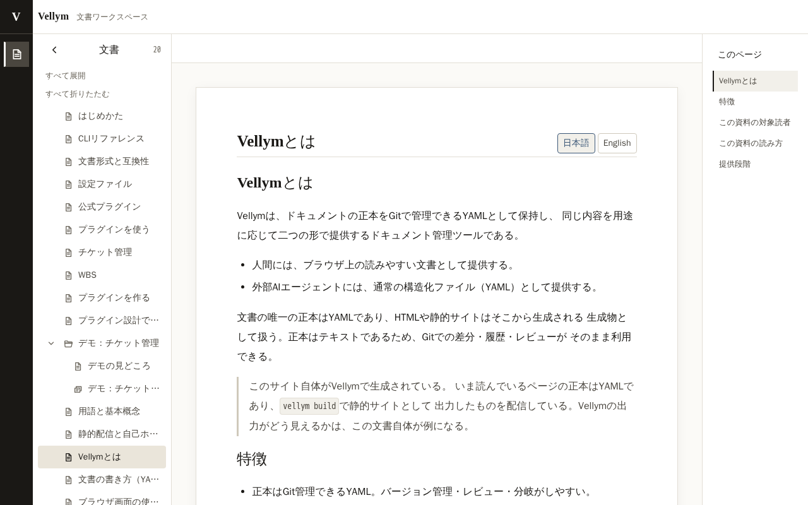
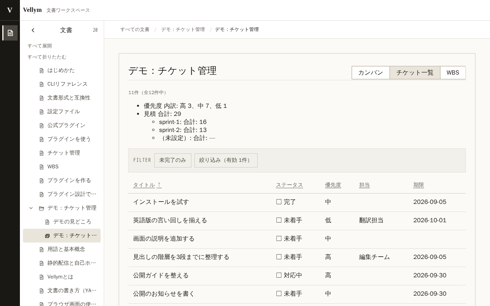
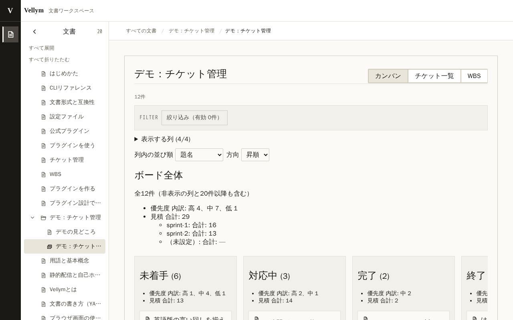
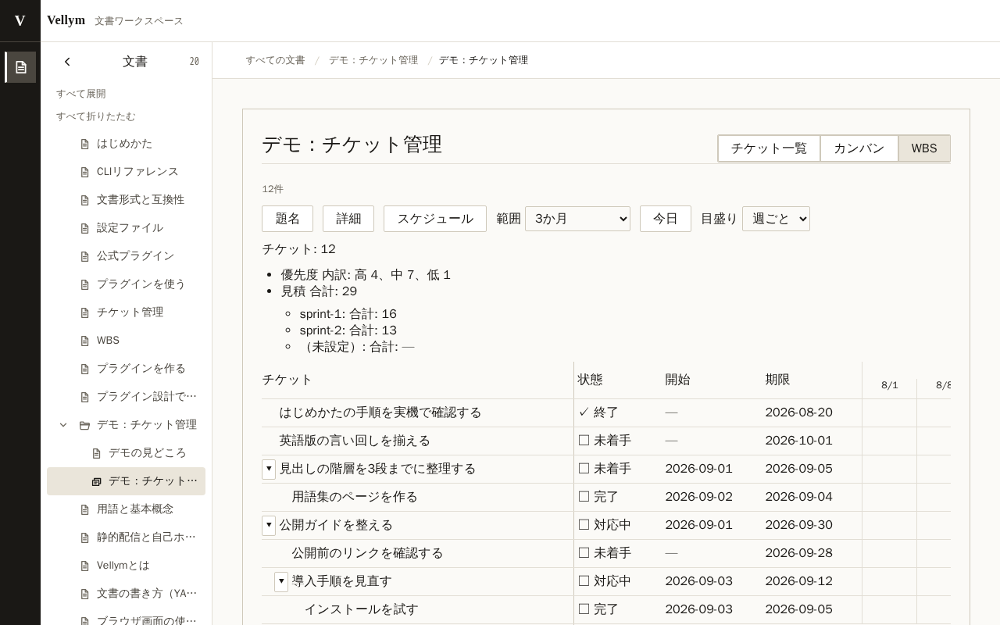

# Vellym

[](https://www.npmjs.com/package/vellym)
[](https://github.com/tasclub/vellym/actions/workflows/ci.yml)
[](LICENSE)
[](https://nodejs.org/)

[English](#english) | [日本語](#日本語)

## English

**A local-first documentation tool that keeps typed YAML under Git as the source of truth, presenting the same content as readable browser pages for people and structured files for AI agents.**






**Try the demo:** <https://vellym.tasclub.com/en/pages/demo-tickets/> (ticket list, Kanban, and WBS on the static site).

Word and Notion are difficult for AI agents to handle structurally, while plain Markdown has weak typing and schema support. Vellym bridges that gap with **Kubernetes-manifest-style typed YAML (`apiVersion` / `kind`) plus a browser interface**. People read and edit visually; engineers and external AI agents work directly with the same YAML. The rendered HTML never drifts from its source.

- **YAML is the source of truth** — review and version it with Git. HTML and diagrams are generated output.
- **One source, two readers** — people (in a browser) and AI agents (through structured files) share the same source.
- **Built for project documentation** — charters, requirements, design decisions, roadmaps, risks, progress, and backlogs. arc42, PMBOK, C4, and ADR are reference frameworks for designing a structure; Vellym does not require compliance or prescribe a process.
- **A neutral container** — no AI model, chat, or generation feature is built into the product. Work locally without vendor lock-in.

> Vellym is in beta, so breaking changes to the document format, CLI, and Plugin API may occur. Format changes will include a `vellym migrate` path and be documented in the changelog; Vellym will release 1.0 once usage has stabilized ([document format and compatibility](https://vellym.tasclub.com/en/#page=document-format)).

> The CLI provides `init`, `add`, `dev`, `validate`, `build`, and `migrate`.

## Quick start

Requirements: Node.js 22.12 or later and npm (tested with Active LTS 22 and 24). Versions earlier than 22.12 are unsupported because they cannot reliably load JSON modules.

```bash
# Initialize a project with the CLI, then start the browser UI
npx vellym init
npm install
npx vellym@beta dev
```

This creates a config, entry page, folders and `VELLYM.md` in `docs/`. Add “For documentation work, read `docs/VELLYM.md`.” to `AGENTS.md`. For ticket management, add `--plugins tickets,kanban` to `init`; see the [setup guide](https://vellym.tasclub.com/en/#page=getting-started).

`dev` binds to `127.0.0.1` by default. Run `vellym dev --host 0.0.0.0` only when you need to connect from outside the container. Then open `http://127.0.0.1:4173` in a browser.

Vellym has no authentication. Anyone who can reach a server started with `--host 0.0.0.0` can read and edit documents and change their structure. Use it only on a trusted network. With the default loopback binding, the `Host` header is restricted to `localhost`, `127.0.0.1`, and `[::1]`.

## Commands

| Command | Purpose |
| --- | --- |
| `vellym init [dir]` | Create a documentation skeleton and configuration. |
| `vellym add --list` | List templates and sets to add. |
| `vellym dev` | Start the local web server for viewing and editing. |
| `vellym validate` | Validate the source YAML against its schemas and report diagnostics. |
| `vellym build` | Generate a read-only static HTML snapshot. |
| `vellym migrate --to v1` | Explicitly migrate `v1alpha1` Page and Folder resources to `v1`. |

```bash
vellym init ./my-docs --root docs --structure by-type --language en
vellym add --list
```

`init` is non-interactive; `--dry-run` previews changes. Add documents as needed with `vellym add` or in the browser. Config discovery checks the current directory, `docs/`, and `vellym/`; use `--config` if more than one exists.

To migrate existing documents to `v1`, commit them to Git, preview the changes with `vellym migrate --to v1 --plan`, then explicitly run `vellym migrate --to v1` to apply them.

## Canonical YAML example

```yaml
apiVersion: vellym.tasclub.com/v1
kind: Page
metadata:
  name: project-charter
  title: Project charter
spec:
  documentType: project-charter
  locale: en
  blocks:
    - id: purpose
      type: rich-text
      format: commonmark
      content: |
        ## Purpose
        ...
```

`format: commonmark` may be omitted: body text is always read as CommonMark (with GFM tables), and no other value has a meaning yet. Headings and prose are yours to edit; `metadata.name`, `blocks[].id` and the shape of `spec` are used by Vellym, so keep them.

Read the [English user guide](https://vellym.tasclub.com/en/) or [日本語の利用ガイド](https://vellym.tasclub.com/).
The official site is generated with Vellym and demonstrates the output of `vellym build`.

## Plugins

Plugins add resource `kind`s through npm packages. A plugin can provide a new kind, its list and detail views, and related operations while keeping the source in the same YAML format.

To install the official ticket-management plugin [`@vellym/tickets`](packages/plugin-tickets/):

```bash
npm install @vellym/tickets
```

```yaml
# vellym.config.yaml
plugins:
  - "@vellym/tickets"
```

The [`@vellym/tickets` README](packages/plugin-tickets/README.md) explains the YAML format for `Ticket` and `TicketTracker`, field types, and where to keep tickets. Add the Kanban view with [`@vellym/kanban`](packages/plugin-kanban/) and see its [README](packages/plugin-kanban/README.md) for setup. Plugin authors can read the [plugin development guide](https://vellym.tasclub.com/en/pages/developing-plugins/).

Removing a plugin does not delete or rewrite the YAML it handled. An unrecognized `kind` is not an error: its content remains available through full-text search and internal links.

<!-- npm-readme:skip-start -->
## Development

This repository is an npm workspaces monorepo. `@vellym-internal/*` packages are private. Host internals are bundled into `vellym` at build time; the shared ticket engine is bundled into the plugins that use it.

```bash
npm ci
npm run typecheck
npm test
npm run build
```

Core verification (automated WCAG checks, search response time with 100 pages, and editor round-trip checks) uses Playwright Chromium. It is only a development and test dependency; it is not included in published packages.

```bash
npx playwright install chromium
npm run verify:core
```

### Dev Container

To develop without installing Node.js on the host, install Docker, VS Code, and the Dev Containers extension, then open this repository with **Reopen in Container**. The root `Dockerfile`'s `development` target runs `npm ci` and `npm run build` when the container is created.

### Runtime image candidate

The `Dockerfile` uses Node.js 24 and Debian Bookworm for its `development`, `builder`, and `runtime` targets. Build the candidate distribution from `runtime`, which contains only the Node.js runtime and generated CLI, UI, and schemas.

```bash
docker build --target runtime -t vellym:local .
docker run --rm -p 127.0.0.1:4173:4173 -v "$PWD/myproject:/workspace" vellym:local
```

Keep Docker's published address limited to `127.0.0.1:4173`; do not expose it to an untrusted network.

<!-- npm-readme:skip-end -->
## Status

Vellym currently provides `init`, `dev`, `validate`, `list`, `build`, and `migrate`. The plugin system (adding resource `kind`s) and the official [`@vellym/tickets`](packages/plugin-tickets/) plugin shipped in `0.4.0-beta`. `0.5.0-beta` adds:

- Reviewing changes, committing, and pushing from the browser, and reading each document's history and diffs ([guide](https://vellym.tasclub.com/en/pages/changes-and-history/))
- Images: insert from the editor, store in an images folder, validate references, and copy them into static output ([guide](https://vellym.tasclub.com/en/pages/images/))
- [`@vellym/kanban`](packages/plugin-kanban/) (Kanban board) and [`@vellym/wbs`](packages/plugin-wbs/) (work breakdown with a date timeline)

`0.5.1-beta` improves WBS breakdown operations and AI entry points, and adds Tracker conditional rules and validation of links to repository files in content.

Additional block types and presets are not implemented. Pull, merge, and branch operations stay on the command line. The `v1` contract may still change before RC.

## License

MIT © tasclub

## Community and support

- User guide: <https://vellym.tasclub.com/en/>
- AI guide index: <https://vellym.tasclub.com/llms.txt>
- Full user guide text for AI agents: <https://vellym.tasclub.com/llms-full.txt> (English: <https://vellym.tasclub.com/en/llms-full.txt>)
- Bugs and feature requests: <https://github.com/tasclub/vellym/issues/new/choose>
- Changelog: [CHANGELOG.md](CHANGELOG.md)
- Contributing: [CONTRIBUTING.md](CONTRIBUTING.md)
- Security: [SECURITY.md](SECURITY.md)
- Document format and compatibility: <https://vellym.tasclub.com/en/#page=document-format>

## 日本語

**Git管理できる型付きYAMLを「正本」とし、同じ実体を人間にはブラウザ上の読みやすい文書として、AIエージェントには構造化ファイルとして両対応で提供する、ローカルファーストの文書管理ツール。**


**デモを触る:** <https://vellym.tasclub.com/pages/demo-tickets/>（静的サイトでチケット一覧・カンバン・WBSを見られる）

Word や Notion は AI エージェントが構造的に扱いにくく、素の Markdown は型・スキーマが弱い。Vellym はその間を **Kubernetes マニフェスト風の型付き YAML（`apiVersion` / `kind`）＋ ブラウザ表示** で埋める。人間は視覚的に読み書きし、エンジニアと外部 AI エージェントは同じ YAML を直接読み書きする。表示用の HTML と正本が乖離しない。

- **正本は YAML** — Git で diff・レビュー・履歴管理できる。HTML と図は生成物。
- **1ソース・2つの読み手** — 人間（ブラウザ）と AI エージェント（構造化ファイル）が同じ正本を共有。
- **プロジェクト文書に特化** — 憲章・要求・設計判断・ロードマップ・リスク・進捗・バックログ。arc42 / PMBOK / C4 / ADR は標準構成を設計するときの参考体系であり、Vellymは準拠や運用手順を強制しない。
- **中立な器** — 製品内へ AI モデル・AI チャット・AI 生成機能を組み込まない。ローカル完結でロックインなし。

> beta版のあいだは文書形式・CLI・Plugin APIに破壊的変更が入り得る。形式変更時は`vellym migrate`による移行手段を用意して変更履歴に記載し、使い方が安定したら正式版（1.0）をリリースする（[文書形式と互換性](https://vellym.tasclub.com/#page=document-format)）。

> CLI は `init` / `add` / `dev` / `validate` / `build` / `migrate` を提供する。

## クイックスタート

必須環境は Node.js 22.12 以降と npm（Active LTS の 22・24 で動作確認）。22.12 未満では JSON モジュールを安定して読み込めないため、動作対象外とする。

Ticket管理には`init`に`--plugins tickets,kanban`を付け、プロジェクト内で`npm install`を実行する。最初のTrackerは画面または[導入ガイド](https://vellym.tasclub.com/#page=getting-started)で作成する。

```bash
# CLI で初期化してからブラウザで起動
npx vellym init
npm install
npx vellym@beta dev
```

`docs/`に設定、入口ページ、フォルダ、`VELLYM.md`ができる。`AGENTS.md`に「文書の作業は `docs/VELLYM.md` を読む。」と追加できる。

`dev` は既定で `127.0.0.1` にバインドする。コンテナ内など外部から接続する場合のみ `vellym dev --host 0.0.0.0` を明示する。起動後はブラウザで `http://127.0.0.1:4173` を開く。

Vellym に認証はない。`--host 0.0.0.0` で起動したサーバーへ到達できる相手は、文書の閲覧・編集・構成変更ができる。信頼できるネットワークだけで使用すること。既定の loopback バインド中は、`Host` を `localhost` / `127.0.0.1` / `[::1]` に限定する。

## コマンド

| コマンド | 役割 |
| --- | --- |
| `vellym init [dir]` | 文書のひな形と設定を作成 |
| `vellym add --list` | 追加できるテンプレートとセットを一覧 |
| `vellym dev` | ローカル Web サーバーを起動し、閲覧・編集 |
| `vellym validate` | 正本 YAML をスキーマ検証し、診断を出力 |
| `vellym build` | 節目の閲覧専用スナップショット（静的 HTML）を生成 |
| `vellym migrate --to v1` | `v1alpha1`のPage／Folderを明示的に`v1`へ移行 |

```bash
vellym init ./my-docs --root docs --structure by-type --language ja
vellym add --list
```

`init`は対話不要で、`--dry-run`で変更を確認できる。必要な文書は`vellym add`または画面で追加する。設定はカレントディレクトリ、`docs/`、`vellym/`を探し、複数ある場合は`--config`で指定する。

既存文書の形式を`v1`へ移す場合は、Gitへcommitした上で`vellym migrate --to v1 --plan`で対象を確認し、`vellym migrate --to v1`を明示的に実行する。

## 正本の形（例）

```yaml
apiVersion: vellym.tasclub.com/v1
kind: Page
metadata:
  name: project-charter
  title: プロジェクト憲章
spec:
  documentType: project-charter
  locale: ja
  blocks:
    - id: purpose
      type: rich-text
      format: commonmark
      content: |
        ## 目的
        ...
```

`format: commonmark`は省略してよい。本文は常にCommonMark（GFMの表を含む）として読まれ、ほかの値にはまだ意味が無い。見出しと説明文は自由に直してよいが、`metadata.name`・`blocks[].id`・`spec`の構造はVellymが使うので変えない。

詳しくは[日本語の利用ガイド](https://vellym.tasclub.com/)または[English user guide](https://vellym.tasclub.com/en/)を参照。公式サイト <https://vellym.tasclub.com/> は Vellym 自身で生成している。`vellym build` の静的サイト出力がどう見えるかは、あのサイトがそのまま例になる。

## プラグイン

npm パッケージで `kind` を追加できる。プラグインは新しい `kind` と、その一覧画面・詳細画面・操作を提供する。正本は同じ YAML のまま増える。

公式のチケット管理 [`@vellym/tickets`](packages/plugin-tickets/) を入れる場合。

```bash
npm install @vellym/tickets
```

```yaml
# vellym.config.yaml
plugins:
  - "@vellym/tickets"
```

`Ticket` と `TicketTracker` の YAML の書き方、フィールド型、チケット管理の置き場所は[`@vellym/tickets` の README](packages/plugin-tickets/README.md)に載せている。カンバン表示を追加する [`@vellym/kanban`](packages/plugin-kanban/) も利用できる。導入と設定は[パッケージの README](packages/plugin-kanban/README.md)を参照。プラグインを作る側の情報は <https://vellym.tasclub.com/pages/developing-plugins/> を参照。

プラグインを外しても、そのプラグインが扱っていた YAML を Vellym が削除・書き換えすることはない。対応するプラグインがない `kind` はエラーにならず、本文は全文検索と内部リンクから引き続き利用できる。

<!-- npm-readme:skip-start -->
## 開発

npm workspaces のモノレポ。`@vellym-internal/*`は非公開の内部パッケージである。ホスト内部は`vellym`へ、チケット共有エンジンはそれを使うプラグインへ、それぞれビルド時にバンドルされる。

```bash
npm ci
npm run typecheck
npm test
npm run build
```

Core の検証（WCAG 自動検査、100 ページ時の検索応答、エディタ往復確認）には Playwright Chromium を使用する（開発・検証専用で配布物には含まれない）。

```bash
npx playwright install chromium
npm run verify:core
```

### Dev Container

ホストへ Node.js を導入せず開発する場合は、Docker・VS Code・Dev Containers 拡張機能を用意し、本リポジトリを **Reopen in Container** で開く。ルート `Dockerfile` の `development` target を使用し、作成時に `npm ci` と `npm run build` を実行する。

### 配布候補 runtime イメージ

`Dockerfile` は Node.js 24／Debian Bookworm を共通基盤に `development` / `builder` / `runtime` を分離する。配布候補は `runtime` target から作成し、Node.js runtime と生成済み CLI・UI・Schema だけを含める。

```bash
docker build --target runtime -t vellym:local .
docker run --rm -p 127.0.0.1:4173:4173 -v "$PWD/myproject:/workspace" vellym:local
```

Docker の公開先は `127.0.0.1:4173` に限定し、同一ネットワークへ不用意に公開しない。

<!-- npm-readme:skip-end -->
## ステータス

現在は `init` / `dev` / `validate` / `list` / `build` / `migrate` を提供する。プラグイン機構（`kind` の追加）と公式の [`@vellym/tickets`](packages/plugin-tickets/) は 0.4.0-beta で提供している。0.5.0-beta で次を加えた。

- 画面からの変更の確認・コミット・プッシュと、文書ごとの履歴と差分（[利用ガイド](https://vellym.tasclub.com/pages/changes-and-history/)）
- 画像: 編集画面からの挿入、画像フォルダへの保存、参照の検証、静的出力へのコピー（[利用ガイド](https://vellym.tasclub.com/pages/images/)）
- [`@vellym/kanban`](packages/plugin-kanban/)（カンバン）と [`@vellym/wbs`](packages/plugin-wbs/)（日程つきのWBS）

0.5.1-betaではWBSの分解操作とAI向けの入口を改善し、Trackerの条件ルールと本文からリポジトリ内ファイルへのリンクの検査を追加した。

追加ブロック、preset は未実装。pull・マージ・ブランチの操作はコマンドラインで行う。`v1`契約はRCまで変更される可能性がある。

## ライセンス

MIT © tasclub

## 開発参加・サポート

- 利用ガイド: <https://vellym.tasclub.com/>
- AI向け案内: <https://vellym.tasclub.com/llms.txt>
- 利用ガイド全文（平文・AIエージェント向け）: <https://vellym.tasclub.com/llms-full.txt>（英語: <https://vellym.tasclub.com/en/llms-full.txt>）
- 不具合・要望: <https://github.com/tasclub/vellym/issues/new/choose>
- 変更履歴: [CHANGELOG.md](CHANGELOG.md)
- 開発参加: [CONTRIBUTING.md](CONTRIBUTING.md)
- セキュリティ: [SECURITY.md](SECURITY.md)
- 文書形式と互換性: <https://vellym.tasclub.com/#page=document-format>
