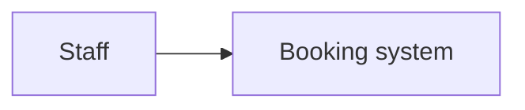

## Goals and quality priorities
What should be achieved and which qualities take priority?
Example: Prioritize reliable bookings.

## External boundaries
What are the boundaries with users and external systems?
Example: Staff book through a browser.

## Components and responsibilities
Which components do what?
| Component | Responsibility |
|---|---|
Example: The API stores bookings.

## Important flows
How do important operations flow?
Example: The screen sends a booking to the API.

## Deployment
Where are the components deployed?
Example: Deploy the API on an internal server.
