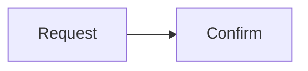

## Business process
Which process is covered?
Example: Meeting room booking.

## Flow diagram
In what order does the process proceed?
Example: From request to confirmation.

## Step descriptions
Who does what at each step?
| Step | Owner | Description |
|---|---|---|
Example: An owner confirms the booking.
