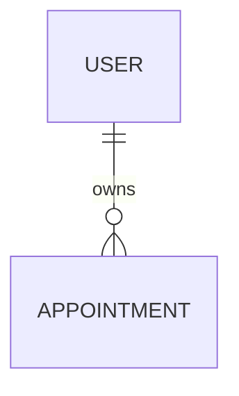

## ER diagram
What entities and relationships exist?
Example: A user owns multiple appointments.

## Table definitions
Which columns and constraints belong to each table?
| Table | Column | Type | Constraints | Description |
|---|---|---|---|---|

## Retention period
How long is data retained?
Example: Keep completed appointments for one year.
