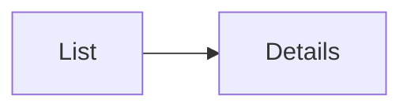

## Screens
Which users need which screens?
| ID | Name | Purpose | User | Screen design link |
|---|---|---|---|---|
Example: Find a booking in the list.

## Screen transition diagram
How do users move between screens?
Example: Move from list to details.

