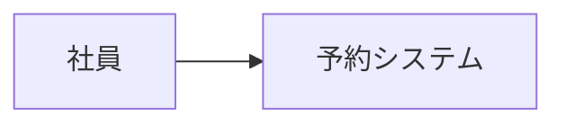

## 目標と品質の優先順位
何を達成し、どの品質を優先しますか？
例: 予約の確実性を優先する。

## 外部との境界
利用者や外部システムとの境界は何ですか？
例: 社員がブラウザから予約する。

## 構成要素と責務
どの要素が何を担当しますか？
| 構成要素 | 責務 |
|---|---|
例: APIが予約を保存する。

## 重要な流れ
重要な処理はどのように流れますか？
例: 画面からAPIへ予約を送る。

## 配置
各要素はどこに配置しますか？
例: 社内サーバーにAPIを配置する。

## 採用する技術の一覧
どの技術を何に使いますか？
| 技術 | 用途 | 選定理由 |
|---|---|---|
例: 組み込みDBを予約の保存に使う。
